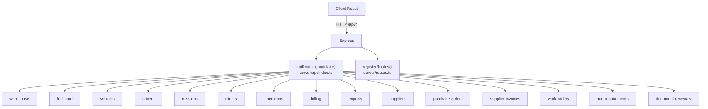

# Cartographie API, dictionnaire et anomalies — FleetMaster 2.0 / Yaro FleetOS

> **Date :** 18 août 2026  
> **Périmètre :** `server/api/*` (modulaire) + `server/routes.ts` (legacy)  
> **Base URL :** `/api`  
> **Auth :** session Express (`req.session.userId`), cookies

---

## Table des matières

1. [Vue d'ensemble](#1-vue-densemble)
2. [Architecture](#2-architecture)
3. [Cartographie par domaine métier](#3-cartographie-par-domaine-métier)
4. [Dictionnaire des endpoints modulaires](#4-dictionnaire-des-endpoints-modulaires)
5. [Dictionnaire des endpoints legacy](#5-dictionnaire-des-endpoints-legacy)
6. [Middleware d'autorisation (RBAC)](#6-middleware-dautorisation-rbac)
7. [Dictionnaire des erreurs HTTP](#7-dictionnaire-des-erreurs-http)
8. [Bugs, failles et dette technique](#8-bugs-failles-et-dette-technique)
9. [Recommandations prioritaires](#9-recommandations-prioritaires)

---

## 1. Vue d'ensemble

| Métrique | Valeur |
|----------|--------|
| Routes modulaires (`server/api/`) | **~123** endpoints |
| Routes legacy (`server/routes.ts`) | **~193** endpoints |
| Total déclaré (avec doublons) | **~280+** |
| Format de réponse erreur dominant | `{ "message": "..." }` |
| Auth principale | Session cookie + middleware `authenticate` |
| Temps réel | WebSocket (`/ws`) + broadcast mission/alertes |

### Principe de montage



**Ordre de montage** (`server/index.ts`) :

1. `app.use("/api", apiRouter)` — routes modulaires (**prioritaires** en cas de conflit)
2. `registerRoutes(app)` — routes legacy (compatibilité)

---

## 2. Architecture

### Fichiers sources

| Fichier | Rôle |
|---------|------|
| `server/index.ts` | Point d'entrée, montage routers, WebSocket, cache désactivé sur `/api` |
| `server/api/index.ts` | Factory `createApiRouter`, health check, montage 16 modules |
| `server/routes.ts` | Monolithe legacy (~6000 lignes), auth, véhicules, OT, pièces, stats… |
| `server/middleware/auth.ts` | `authenticate`, `authorize`, rôles métier |
| `server/middleware/session.ts` | Session Express |

### Modules modulaires (`server/api/`)

| Préfixe | Fichier | Endpoints | Auth globale |
|---------|---------|-----------|--------------|
| `/api/warehouse` | `warehouse.routes.ts` | 9 | `authenticate` sur chaque route |
| `/api/fuel-card` | `fuel-card.routes.ts` | 8 | Partielle (voir §8) |
| `/api/vehicles` | `vehicles.routes.ts` | 7 | **Aucune** sur les routes |
| `/api/drivers` | `drivers.routes.ts` + `drivers-management.routes.ts` | 15 | Partielle |
| `/api/missions` | `missions.routes.ts` | 12 | **Aucune** |
| `/api/clients` | `clients.routes.ts` | 7 | Partielle (`authorize` sur écriture) |
| `/api/operations` | `operations.routes.ts` | 8 | `authenticate` |
| `/api/billing` | `billing.routes.ts` | 9 | `canAccessBilling` / `canRecordPayment` |
| `/api/exports` | `exports.routes.ts` | 8 | `authenticate` |
| `/api/suppliers` | `suppliers.routes.ts` | 11 | Lectures **sans auth** |
| `/api/purchase-orders` | `purchase-orders.routes.ts` | 9 | `requireAuth` + RBAC écriture |
| `/api/supplier-invoices` | `supplier-invoices.routes.ts` | 15 | RBAC granulaire |
| `/api/work-orders` | `work-order-parts.routes.ts` | 3 | Mixte |
| `/api/part-requirements` | `part-requirements.routes.ts` | 7 | RBAC workflow pièces |
| `/api/document-renewals` | `document-renewals.routes.ts` | 5 | `router.use(authenticate)` |

---

## 3. Cartographie par domaine métier

### 3.1 Authentification & utilisateurs

| Domaine | Préfixe | Source | Nb approx. |
|---------|---------|--------|------------|
| Auth session | `/api/auth/*` | legacy | 6 |
| Utilisateurs | `/api/users/*`, `/api/admin/users/*` | legacy | 14 |
| Onboarding | `/api/onboarding/*` | legacy | 4 |

### 3.2 Flotte — véhicules & documents

| Domaine | Préfixe | Source |
|---------|---------|--------|
| CRUD véhicules | `/api/vehicles/*` | legacy (+ modular docs) |
| Documents véhicule | `/api/vehicles/:id/documents`, `/api/documents/*` | legacy |
| Docs expirés / stats | `/api/vehicles/expiring-docs`, `document-stats`… | modular |
| Kilométrage | `/api/vehicles/:id/mileage/*` | legacy |
| Workflows acquisition | `/api/workflows/vehicle-acquisition/*` | legacy |
| Renouvellement docs | `/api/document-renewals/*` | modular |

### 3.3 Maintenance & ordres de travail (OT)

| Domaine | Préfixe | Source |
|---------|---------|--------|
| Plans maintenance | `/api/maintenance-schedules/*` | legacy |
| OT (work orders) | `/api/work-orders/*` | legacy + modular (pièces) |
| Technicien | `/api/technician/*` | legacy |
| Catalogue pannes | `/api/fault-catalog/*` | legacy |
| Pneus | `/api/tires/*`, `/api/vehicle-tires/*`, `/api/tire-*` | legacy |

### 3.4 Inventaire & pièces

| Domaine | Préfixe | Source |
|---------|---------|--------|
| Catalogue pièces | `/api/parts/*` | legacy |
| Entrepôt / stock | `/api/warehouse/*` | **doublon** legacy + modular |
| Demandes pièces (workflow) | `/api/part-requirements/*` | modular |
| OT ↔ pièces | `/api/work-orders/:id/parts`, `/api/parts-used/*` | legacy + modular |

### 3.5 Carburant & missions

| Domaine | Préfixe | Source |
|---------|---------|--------|
| Carte carburant | `/api/fuel-card/*` | **doublon** legacy + modular |
| Enregistrements carburant | `/api/fuel-records/*` | legacy |
| Missions transport | `/api/missions/*` | modular |
| Opérations client | `/api/operations/*` | modular |
| Chauffeurs CPC | `/api/drivers/*` | modular |

### 3.6 Procurement & facturation

| Domaine | Préfixe | Source |
|---------|---------|--------|
| Fournisseurs | `/api/suppliers/*` | modular + legacy (`summary`, `invoices`) |
| Commandes achat | `/api/purchase-orders/*` | modular |
| Factures fournisseurs | `/api/supplier-invoices/*` | modular |
| Facturation clients | `/api/billing/*` | modular |
| Factures legacy | `/api/invoices/*` | legacy |

### 3.7 Reporting, stats & alertes

| Domaine | Préfixe | Source |
|---------|---------|--------|
| Statistiques flotte | `/api/statistics/*` | legacy |
| Dashboard technicien | `/api/dashboard/technician-stats` | legacy |
| Rapports | `/api/reports/*` | legacy |
| Exports Excel | `/api/exports/*` | **doublon** legacy + modular |
| Alertes | `/api/alerts/*` | legacy (**doublon interne**) |

### 3.8 Dev / test (à surveiller en prod)

| Route | Auth | Risque |
|-------|------|--------|
| `POST /api/test-mileage-maintenance` | **Aucune** | Génère des OT |
| `POST /api/test-date-maintenance` | `authenticate` | Test maintenance |
| `POST /api/check-all-maintenance` (×2) | Mixte | Cron / batch |
| `DELETE /api/dev/work-orders-all` | `authenticate` seulement | Supprime tous les OT |

---

## 4. Dictionnaire des endpoints modulaires

> Légende auth : ✅ `authenticate` | 🔒 RBAC métier | ⚠️ Aucune auth explicite | 🔐 `router.use(authenticate)`

### 4.1 Health

| Méthode | Path | Auth | Description |
|---------|------|------|-------------|
| GET | `/api/health` | ⚠️ | Statut API + liste services (modular) |
| GET | `/api/health` | ⚠️ | Doublon legacy (routes.ts L117) |

### 4.2 Missions — `/api/missions` ⚠️

| Méthode | Path | Auth | Body / Query | Réponses clés |
|---------|------|------|--------------|---------------|
| GET | `/` | ⚠️ | `?status`, pagination | 200 liste missions |
| GET | `/:id` | ⚠️ | — | 200 / 404 |
| POST | `/` | ⚠️ | `insertMissionSchema` + `assignment?` | 201 ; **createdBy = session \|\| 1** |
| PATCH | `/:id` | ⚠️ | champs mission | 200 / 400 |
| PUT | `/:id/status` | ⚠️ | `{ status }` | 200 / 400 |
| GET | `/:id/fuel-records` | ⚠️ | — | 200 |
| POST | `/:id/fuel-records` | ⚠️ | enregistrement carburant | 201 / 400 |
| POST | `/:id/fuel-records/regularize` | ⚠️ | régularisation | 200 / 400 |
| POST | `/:id/fuel-records/declare-no-refuel` | ⚠️ | — | 200 |
| GET | `/:id/launch-readiness` | ⚠️ | — | 200 checklist départ |
| GET/POST | `/:id/document-renewal-requests` | ⚠️ | — | 200 / 201 |

**Erreurs métier fréquentes :**

- `400` — « Affectation invalide (véhicule/chauffeur). »
- `400` — « Véhicule introuvable pour l'affectation. »
- `400` — « Chauffeur introuvable pour l'affectation. »
- `400` — « Charge incompatible: {poids}T > tonnage véhicule {immat} ({tonnage}T). »
- `400` — CPC chauffeur non « FORMÉ »

### 4.3 Part requirements — `/api/part-requirements` 🔒

| Méthode | Path | Auth | Rôles | Description |
|---------|------|------|-------|-------------|
| GET | `/` | ✅ | tous auth | Liste demandes (filtres) |
| GET | `/active-by-part` | ✅ | tous auth | Demandes actives groupées par pièce |
| GET | `/by-part/:partId` | ✅ | tous auth | Historique pièce |
| GET | `/workflow/statuses` | ✅ | tous auth | Statuts + labels FR |
| POST | `/` | 🔒 | `isPartRequester` | Créer demande |
| PATCH | `/:id` | 🔒 | `isInventoryManager` | Changer statut workflow |
| DELETE | `/:id` | 🔒 | `isWorkshopManager` | Annuler demande |

**Statuts workflow :** `pending` → `approved` → `ordered` → `received` → `issued` (libellés FR centralisés dans `shared/constants/part-requirements.ts`).

### 4.4 Work orders (pièces) — `/api/work-orders`

| Méthode | Path | Auth | Description |
|---------|------|------|-------------|
| GET | `/:workOrderId/pending-part-requirements` | ✅ | Demandes en attente sur OT |
| POST | `/:workOrderId/awaiting-parts` | 🔒 technicien | Passer OT en attente pièces |
| POST | `/:workOrderId/part-requirements/:requirementId/issue` | 🔒 technicien | Sortie stock / clôture demande |

> **Doublon legacy :** `GET/POST /api/work-orders/:workOrderId/parts` dans `routes.ts`.

### 4.5 Warehouse — `/api/warehouse` ✅

| Méthode | Path | Description |
|---------|------|-------------|
| GET | `/inventory-value` | Valeur stock totale |
| GET | `/reorder-alerts` | Alertes réapprovisionnement |
| GET | `/parts/:id/real-stock` | Stock réel pièce |
| POST | `/stock-movement` | Mouvement stock (`isInventoryManager`) |
| GET | `/most-used-parts` | Pièces les plus consommées |
| GET | `/statistics` | Stats entrepôt |
| GET | `/parts-by-supplier` | Répartition par fournisseur |
| GET | `/top-consumed-parts` | Top consommation |
| GET | `/stock-value-history` | Historique valeur stock |

> **Doublon :** mêmes routes recopiées dans `routes.ts` (L376–391 et L3232–3381).

### 4.6 Fuel card — `/api/fuel-card` ⚠️/🔒

| Méthode | Path | Auth | Description |
|---------|------|------|-------------|
| GET | `/balance` | ⚠️ | Solde carte |
| POST | `/recharge` | 🔒 `isFuelCardManager` | Recharge |
| POST | `/consumption` | ⚠️ | Consommation |
| GET | `/history` | ⚠️ | Historique |
| GET | `/vehicle/:vehicleId/stats` | ⚠️ | Stats véhicule |
| GET | `/vehicle/:vehicleId/anomalies` | ⚠️ | Anomalies |
| GET | `/stats-by-client` | ⚠️ | Par client |
| GET | `/monthly-stats` | ⚠️ | Mensuel |

> Legacy `routes.ts` L3847+ réimplémente les mêmes routes **avec** `authenticate`.

### 4.7 Suppliers — `/api/suppliers` ⚠️

| Méthode | Path | Auth écriture | Auth lecture |
|---------|------|---------------|--------------|
| GET | `/`, `/top`, `/search`, `/:id`, `/:id/performance` | — | **⚠️ Aucune** |
| POST | `/` | `checkWritePermission` | — |
| PATCH | `/:id`, `/:id/rating`, `/:id/reactivate` | RBAC | — |
| DELETE | `/:id` | `checkWritePermission` | — |
| POST | `/:id/calculate-ratings` | `checkEvaluationPermission` | — |

### 4.8 Purchase orders — `/api/purchase-orders` ✅

| Méthode | Path | Auth |
|---------|------|------|
| GET | `/`, `/statistics`, `/overdue`, `/:id` | `requireAuth` |
| GET | `/group-suggestions` | auth + write |
| POST | `/optimize-timing/:supplierId` | auth + write |
| POST | `/` | auth + write |
| PATCH | `/:id/status`, `/:id/lines/:lineId` | auth + write |

### 4.9 Supplier invoices — `/api/supplier-invoices` 🔒

CRUD + workflow validation (`validate`, `approve`), règlements (`settlements`, `payment`), import, écarts (`discrepancies`), auto-approve. Permissions : `checkReadPermission`, `checkCreatePermission`, `checkApprovalPermission`, `checkPaymentPermission`.

### 4.10 Billing clients — `/api/billing` 🔒

| Méthode | Path | Description |
|---------|------|-------------|
| POST | `/invoices/generate` | Génération facture |
| GET | `/invoices`, `/invoices/summary`, `/invoices/:id` | Consultation |
| POST/GET | `/invoices/:id/payments` | Paiements |
| GET | `/invoices/:id/pdf` | Export PDF |
| GET | `/reports/:clientName`, `/statistics` | Reporting |

### 4.11 Exports — `/api/exports` ✅

Excel : `supplier-invoices`, `inventory`, `fuel-consumption`, `client-operations`, `client-invoices`, `monthly-report`, `fuel-statistics`, `client-missions`.

> Legacy : `/api/exports/vehicles`, `work-orders`, `inventory`, `fuel`, `users`, `complete`.

### 4.12 Document renewals — `/api/document-renewals` 🔐

| Méthode | Path | Description |
|---------|------|-------------|
| GET | `/centers` | Centres agréés |
| GET/POST | `/requests` | Demandes renouvellement |
| PATCH | `/requests/:id/status` | Mise à jour statut |
| POST | `/quick-renew` | Renouvellement rapide |

### 4.13 Clients, drivers, vehicles, operations

Voir fichiers `clients.routes.ts`, `drivers.routes.ts`, `drivers-management.routes.ts`, `vehicles.routes.ts`, `operations.routes.ts` — détail dans §5 pour le chevauchement legacy.

---

## 5. Dictionnaire des endpoints legacy

Fichier : `server/routes.ts` (~193 routes). Groupées par préfixe.

### 5.1 Auth (`/api/auth/*`)

| Méthode | Path | Auth | Erreurs |
|---------|------|------|---------|
| POST | `/login` | — | 400 credentials manquants ; 401 invalides |
| POST | `/pin-login` | — | 401 PIN ; 403 non chauffeur |
| GET | `/drivers-list` | — | Liste pour login PIN |
| POST | `/register` | — | 400 username/email existant |
| GET | `/me` | ✅ | 401 / 404 |
| POST | `/logout` | — | 200 |

### 5.2 Véhicules (`/api/vehicles/*`) — ~20 routes

CRUD (`GET`, `POST`, `PATCH`, `DELETE`), archivage, documents, vérification immatriculation, alertes, historique statut, pneus montés.

Auth : `authenticate` lecture ; `isWorkshopManager` / `isAdmin` écriture.

### 5.3 Maintenance schedules — **DOUBLONS**

| Méthode | Path | Lignes | Note |
|---------|------|--------|------|
| GET | `/api/maintenance-schedules` | **1530 + 1647** | Handler dupliqué |
| PATCH | `/api/maintenance-schedules/:id` | **1747 + 1794** | Handler dupliqué |

### 5.4 Work orders (`/api/work-orders/*`) — ~15 routes

Liste, stats, awaiting-parts, CRUD, bulk delete admin, pièces, rotations pneus.

**Anomalie :**

| Méthode | Path | Auth |
|---------|------|------|
| GET | `/api/technician/work-orders/:technicianId` | **⚠️ AUCUNE** |
| GET | `/api/technician/my-work-orders` | ✅ |
| PATCH | `/api/technician/work-orders/:id/status` | ✅ |

### 5.5 Pièces (`/api/parts/*`) — ~18 routes

Catalogue, stats, stock, mouvements, historique, `update-stock`, usage-history (**doublon L3171 + L3212**).

### 5.6 Fuel records (`/api/fuel-records/*`)

CRUD + stats + historique consommation. Auth `authenticate` / `isWorkshopManager`.

### 5.7 Statistiques (`/api/statistics/*`)

| Route | Doublon |
|-------|---------|
| `GET /api/statistics/fleet-history` | **L4597 + L4714** |

Autres : `fleet`, `fleet-kpi`, `maintenance-compliance`, `maintenance-cost/:period`, `scheduled-maintenance`, `work-orders`.

### 5.8 Alertes (`/api/alerts/*`) — **DOUBLON BLOC ENTIER**

Bloc 1 : L4291–4486  
Bloc 2 : L5687–5730 (recopie partielle de `unread`, `/`, `read`, `delete`)

### 5.9 Workflows, pneus, onboarding, admin

- Workflows actifs, upload documents, acquisition véhicule
- Pneus : catalogue, inspections, rotations
- Onboarding utilisateur (4 routes)
- `POST /api/admin/import-backup` (admin)
- Documentation admin (`/api/documentation`)

---

## 6. Middleware d'autorisation (RBAC)

Défini dans `server/middleware/auth.ts` :

| Middleware | Rôles autorisés |
|------------|-----------------|
| `authenticate` | Session valide |
| `isAdmin` | `admin` |
| `isWorkshopManager` | `admin`, `workshop_manager` |
| `isTechnician` | `admin`, `workshop_manager`, `technician` |
| `isInventoryManager` | `admin`, `workshop_manager`, `warehouse`, `secretary` |
| `isPartsCatalogManager` | `admin`, `warehouse` |
| `isTireCatalogManager` | `admin`, `warehouse` — fiche pneu en stock (`POST/PATCH /api/tires`) |
| `isPartRequester` | `admin`, `workshop_manager`, `technician`, `warehouse` |
| `isDriverManager` | `admin`, `logistics`, `secretary` |
| `isFuelCardManager` | `admin`, `logistics`, `secretary` |
| `authorize([...])` | Liste custom + alias FR (`magasinier` → `warehouse`, etc.) |

**Alias rôles supportés :** `administrateur`, `gestionnaire_atelier`, `technicien`, `secrétaire`, `logisticien`, `magasinier`.

---

## 7. Dictionnaire des erreurs HTTP

### 7.1 Format standard

```json
{ "message": "Description lisible en français" }
```

Variantes occasionnelles :

```json
{ "message": "...", "details": "..." }
{ "message": "...", "errors": [...] }   // validation Zod
```

### 7.2 Codes HTTP utilisés

| Code | Usage |
|------|-------|
| **400** | Validation, doublon métier, ID invalide, règle métier violée |
| **401** | Non authentifié, credentials invalides, session expirée |
| **403** | Rôle insuffisant, accès ressource interdit |
| **404** | Entité introuvable |
| **409** | Conflit (rare, surtout procurement) |
| **500** | Erreur serveur générique |
| **204** | Suppression OK sans body (workflows documents) |

### 7.3 Messages 401 — authentification

| Message | Contexte |
|---------|----------|
| `Non authentifié` | Middleware `authenticate` / `authorize` |
| `Utilisateur non authentifié` | Variante legacy routes |
| `Utilisateur non trouvé` | Session orpheline |
| `Identifiants invalides` | Login username/password |
| `PIN incorrect` | Login PIN chauffeur |
| `Aucun PIN configuré` | Chauffeur sans PIN |
| `Mot de passe actuel incorrect` | Changement mot de passe |

### 7.4 Messages 403 — autorisation

| Message | Contexte |
|---------|----------|
| `Accès non autorisé` | `authorize()` rôle insuffisant |
| `Accès réservé aux administrateurs uniquement` | `isAdmin` |
| `Accès réservé aux chauffeurs` | PIN login non chauffeur |
| `Accès non autorisé à ce véhicule` | Scope véhicule client |

### 7.5 Messages 400 — validation fréquents

| Message | Domaine |
|---------|---------|
| `Nom d'utilisateur déjà utilisé` | Users |
| `Email déjà utilisé` | Users |
| `Numéro d'immatriculation déjà utilisé` | Véhicules |
| `ID invalide` / `ID de véhicule invalide` | Parsing param |
| `Nom d'utilisateur et mot de passe requis` | Login |
| `Mot de passe actuel et nouveau mot de passe requis` | Password |
| `Le nouveau mot de passe doit contenir au moins 6 caractères` | Password |
| `Vous ne pouvez pas supprimer votre propre compte` | Admin users |
| `vehicleId et currentMileage requis` | Test maintenance |

### 7.6 Messages 404

| Message | Domaine |
|---------|---------|
| `Utilisateur non trouvé` | Users |
| `Véhicule non trouvé` | Véhicules |
| `Utilisateur non trouvé ou déjà supprimé` | Delete user |

### 7.7 Messages 500

| Message | Note |
|---------|------|
| `Erreur serveur` | **~80 % des catch blocks** — peu actionnable côté client |
| `Erreur d'authentification, veuillez réessayer plus tard` | Login exception |
| `Erreur lors de la création dans la base de données` | Create user |
| Messages métier spécifiques | maintenance, exports, workflows… |

### 7.8 Incohérences de wording (dette)

| Variante A | Variante B | Recommandation |
|------------|------------|----------------|
| `Non authentifié` | `Utilisateur non authentifié` | Unifier |
| `Utilisateur non trouvé` | `Utilisateur non trouvé` (404 vs 401) | Clarifier sémantique HTTP |
| `Erreur serveur` | Messages détaillés avec `details` | Standardiser `{ code, message }` |

---

## 8. Bugs, failles et dette technique

### 🔴 Critique — Sécurité

| # | Problème | Fichier | Impact |
|---|----------|---------|--------|
| S1 | **12 routes missions sans `authenticate`** | `missions.routes.ts` | Lecture/écriture missions, carburant, statuts accessibles sans session |
| S2 | **`createdBy = session?.userId \|\| 1`** sur POST mission | `missions.routes.ts` L1683 | Missions anonymes attribuées à l'utilisateur ID 1 |
| S3 | **GET suppliers sans auth** (5 routes lecture) | `suppliers.routes.ts` | Fuite données fournisseurs / performance |
| S4 | **GET `/api/technician/work-orders/:technicianId` sans auth** | `routes.ts` L2414 | OT d'un technicien lisibles par ID |
| S5 | **`POST /api/check-all-maintenance` sans auth** (2e handler) | `routes.ts` L5458 | Déclenche génération OT en masse |
| S6 | **`POST /api/test-mileage-maintenance` sans auth** | `routes.ts` L1691 | Génère des OT de test |
| S7 | **Fuel-card modular : lectures sans auth** | `fuel-card.routes.ts` | Solde, historique, anomalies exposés (legacy protège avec auth) |
| S8 | **Vehicles modular : 7 routes sans auth** | `vehicles.routes.ts` | Docs expirés, kilométrage, statuts |
| S9 | **Drivers modular : CPC sans auth** | `drivers.routes.ts` | Données chauffeurs / CPC |
| S10 | **`DELETE /api/dev/work-orders-all`** — auth seulement, pas admin | `routes.ts` L5445 | Destruction masse OT en prod si laissé actif |

### 🟠 Majeur — Doublons & comportement imprévisible

| # | Problème | Détail |
|---|----------|--------|
| D1 | Routes **warehouse** dupliquées | Modular monté en 1er → legacy mort ou divergent |
| D2 | Routes **fuel-card** dupliquées | Comportement auth **différent** modular vs legacy |
| D3 | Routes **exports/inventory** dupliquées | Même path, implémentations possibles différentes |
| D4 | **`GET /api/maintenance-schedules`** ×2 | L1530 + L1647 |
| D5 | **`PATCH /api/maintenance-schedules/:id`** ×2 | L1747 + L1794 |
| D6 | **`GET /api/parts/:id/usage-history`** ×2 | L3171 + L3212 |
| D7 | **`GET /api/statistics/fleet-history`** ×2 | L4597 + L4714 |
| D8 | **Bloc alertes dupliqué** | L4291–4486 vs L5687–5730 |
| D9 | **`POST /api/check-all-maintenance`** ×2 | L5143 (auth) vs L5458 (**sans auth**) — le 2e écrase le 1er dans Express |
| D10 | **`GET /api/health`** ×2 | modular + legacy |

### 🟡 Modéré — Qualité API

| # | Problème | Détail |
|---|----------|--------|
| Q1 | Pas de versioning (`/api/v1`) | Risque breaking changes |
| Q2 | Pas de `code` erreur machine-readable | Client doit parser le texte FR |
| Q3 | Logging auth verbeux par défaut | `AUTH_DEBUG !== "0"` → logs session en prod |
| Q4 | Mélange REST conventions | `PUT` status vs `PATCH` update |
| Q5 | Routes test/dev en codebase prod | `test-*`, `dev/work-orders-all` |
| Q6 | **`GET /api/clients/`** sans auth, **`GET /all`** avec RBAC | Incohérence |
| Q7 | Work-orders parts : legacy + modular | Deux chemins pour pièces OT |

### 🟢 Mineur — Documentation & DX

| # | Problème |
|---|----------|
| M1 | Pas d'OpenAPI/Swagger généré |
| M2 | Commentaires « Phase 2 Sprint X » dispersés |
| M3 | Health check modular expose métriques métier hardcodées |

---

## 9. Recommandations prioritaires

### Sprint sécurité (P0)

1. Ajouter `router.use(authenticate)` sur `missions.routes.ts`, `vehicles.routes.ts`, `drivers.routes.ts`, `fuel-card.routes.ts` (lectures).
2. Supprimer le fallback `|| 1` sur `createdBy` — rejeter 401 si pas de session.
3. Protéger GET suppliers ou appliquer RBAC lecture.
4. Ajouter `authenticate` sur `GET /api/technician/work-orders/:technicianId`.
5. Supprimer ou garder sous flag env les routes `test-*`, `dev/*`, et le 2e handler `check-all-maintenance`.

### Refactoring (P1)

1. Supprimer doublons dans `routes.ts` (alertes, maintenance-schedules, fleet-history, usage-history, warehouse, fuel-card).
2. Choisir **une** source de vérité : modular **ou** legacy par domaine, puis déprécier l'autre.
3. Unifier format erreur : `{ code: "PART_NOT_FOUND", message: "..." }`.

### Documentation (P2)

1. Générer OpenAPI depuis les routers modulaires.
2. Documenter matrice rôle × endpoint (compléter `docs/guides/PROFILS_ACCES.md`).

---

## Annexe — Index des fichiers routes

```
server/
├── index.ts
├── routes.ts                    # Legacy monolith (~193 routes)
├── middleware/
│   ├── auth.ts
│   └── session.ts
└── api/
    ├── index.ts
    ├── billing.routes.ts
    ├── clients.routes.ts
    ├── document-renewals.routes.ts
    ├── drivers.routes.ts
    ├── drivers-management.routes.ts
    ├── exports.routes.ts
    ├── fuel-card.routes.ts
    ├── missions.routes.ts
    ├── operations.routes.ts
    ├── part-requirements.routes.ts
    ├── purchase-orders.routes.ts
    ├── supplier-invoices.routes.ts
    ├── suppliers.routes.ts
    ├── vehicles.routes.ts
    ├── warehouse.routes.ts
    └── work-order-parts.routes.ts
```

---

*Document généré par analyse statique du code source. Pour valider les failles S1–S10, exécuter des requêtes curl sans cookie de session contre l'environnement cible.*
