# Plan de couverture des tests par module

Objectif : couvrir chaque module en **CRUD**, **suppression (soft delete / désactivation)**,
**workflows (transitions de statut)** et **RBAC**, puis les parcours bout en bout inter-rôles.

Sources : `shared/schema.ts` (tables, statuts, colonnes `deleted_at` / `is_active`),
`shared/constants/` (statuts des demandes de pièce, lignes OT), suites existantes
(`e2e/`, `tests/contract/`, `tests/integration/`).

## Légende

| Niveau | Outil | Emplacement |
|---|---|---|
| **U** | Vitest unitaire, sans base | `tests/unit/` |
| **I** | Vitest services + `DATABASE_URL_TEST` | `tests/integration/` |
| **C** | Vitest HTTP in-process + `DATABASE_URL_TEST` | `tests/contract/` |
| **E** | Playwright | `e2e/` |
| **M** | Recette manuelle | `docs/qa/` |

| État | Sens |
|---|---|
| OK | Test existant et vert |
| Partiel | Test existant, ne couvre pas tous les cas listés |
| À rejouer | Test existant, non relancé récemment |
| À faire | Aucun test |

Règle des tests en base : tout ce qui est créé est supprimé en fin de test (préfixe `TEST-`).
Arrêter le serveur de dev avant les tests de contrat (le planificateur d'alertes bloque la purge).

---

## 1. Carte des modules

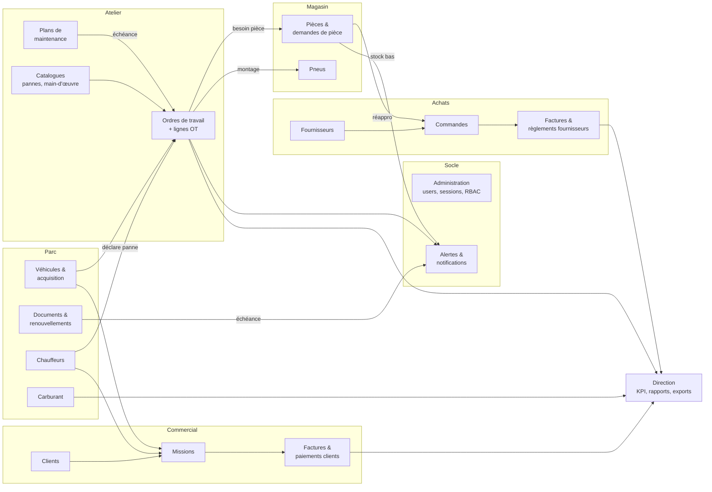

---

## 2. Tests transverses (tous modules)

| # | Test | Niveau | État |
|---|---|---|---|
| T1 | Toute route `/api` : 401 sans session, 403 avec rôle non autorisé | C / E | Partiel (`api-auth-guard` statique ; 403 par session réelle sur 7 POST principaux dans `api-role-guard-and-validation`, sur l'ajustement de stock et sur la saisie/modification d'un plein (`fuel-records-and-document-paths`) ; cloison entre clients et saisies réservées au personnel (`vehicle-documents-client-scope`) ; E : 403 forgé au contrat d'erreur, bouton de paiement désactivé avec sa raison, corbeille pièce masquée au magasinier, `e2e/07`, `e2e/08`) |
| T2 | Sessions : création, expiration, révocation, logout | C | OK (`api-auth-sessions`) |
| T3 | Body invalide → 400 Zod avec message actionnable | C | Partiel (7 POST principaux + PATCH véhicule, OT, fournisseur, client, pièce, pneu, panne couverts par `api-role-guard-and-validation` ; ajustement de stock ; PATCH document, planification, utilisateur, POST/PATCH plein carburant, POST catalogue de pannes dans `secondary-routes-validation` ; E : toast métier sans détail technique, `e2e/08` ; reste les autres routes de `server/routes.ts`, à brancher sur `prepareColumnUpdate`) |
| T4 | Champs serveur ignorés si envoyés par le client (`created_by`, `updated_by`, prix, totaux) | C | Partiel (prix pièce OT, champs d'audit au PATCH pièce, `requestedBy` et statut/date de livraison à la création d'une demande de pièce, ratchet `insert-schemas-server-fields` ; commande fournisseur : totaux recalculés, remise bornée 0..100, quantités reçues bornées et jamais en baisse, `purchase-order-amounts` ; facture client : montant borné, TVA/TTC recalculés, `client-invoice-generate` ; facture fournisseur : champs du workflow ignorés, solde initial = TTC, `supplier-invoice-create`) |
| T5 | Audit `parts` / `tires` : `created_by` + `updated_by` à la création, `updated_by` à chaque modification | I | À faire |
| T6 | Règle des 3 couches : cache local, trame WebSocket chez un autre rôle, invalidation liste + KPI | E | Partiel (`06-realtime-work-orders`) |
| T7 | Idempotence : double soumission sans doublon (paiement, réception, sortie de stock) | C / E | Fait (réception et sortie de stock, règlement et rapprochement fournisseur, encaissement client, ajustement de stock ; E : double clic encaissement et ajustement, `e2e/07` ; garde `useSingleFlightMutate` aussi sur règlement et rapprochement fournisseur, réception et sortie de demande, sortie depuis l'OT, livraison de commande) |
| T8 | Listes : pagination, filtres, recherche, éléments supprimés exclus | C | À faire |

---

## 3. Tests par module

### 3.1 Administration et utilisateurs

Tables : `users` (soft delete `deleted_at`), `userOnboarding`, `activityLogs`.

| # | Test | Niveau | État |
|---|---|---|---|
| ADM1 | CRUD utilisateur par admin, 403 pour les autres rôles | C | Partiel (PATCH : 400 par champ, 409 doublon, champs serveur conservés, `secondary-routes-validation` ; 403 à faire) |
| ADM2 | Changement de rôle : menus et droits appliqués à la session suivante | E | À faire |
| ADM3 | Soft delete : connexion refusée, session révoquée, absent des listes, historique conservé | C | À faire |
| ADM4 | Login / logout, mauvais mot de passe | E | OK (`01-auth-login`) |
| ADM5 | PIN chauffeur : bon PIN, mauvais PIN, chauffeur désactivé | C | À faire |
| ADM6 | Journal d'activité alimenté sur les actions sensibles | I | À faire |

### 3.2 Parc véhicules

Tables : `vehicles` (soft delete `deleted_at`), `vehicleAcquisitionWorkflows`, `workflowDocuments`, `vehicleDocuments`, `statusHistory`.

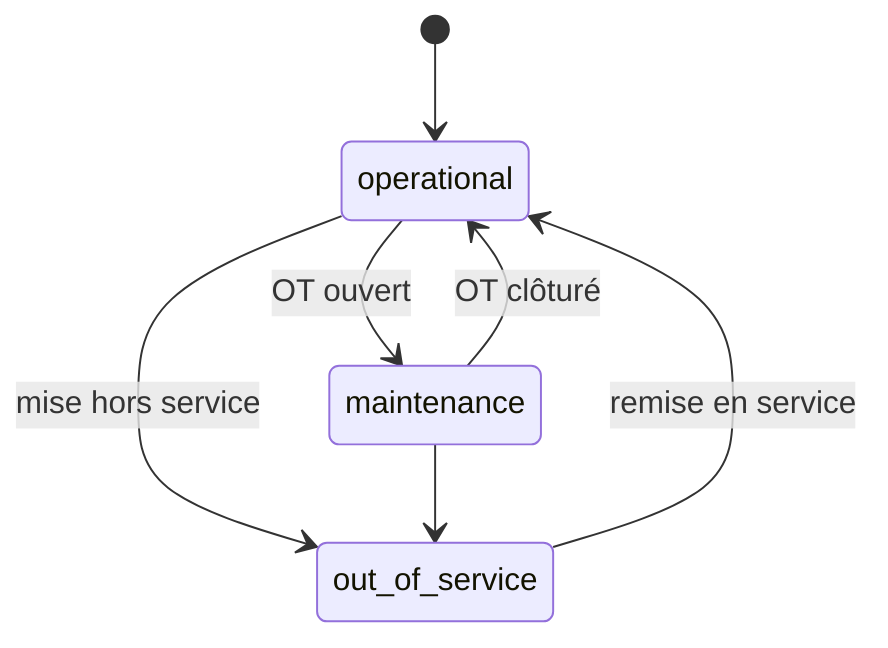

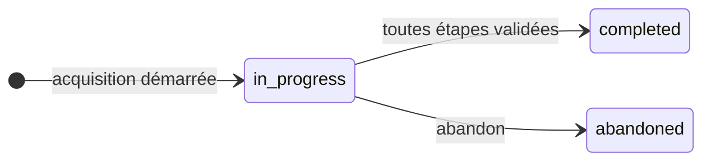

| # | Test | Niveau | État |
|---|---|---|---|
| VEH1 | CRUD véhicule, unicité immatriculation | E / C | Partiel (`02-fleet-vehicles`) |
| VEH2 | Soft delete : masqué, OT et missions passés consultables, non assignable | C | À faire |
| VEH3 | Acquisition : reprise de l'étape en cours, documents joints, `completed` / `abandoned` | E | À faire |
| VEH4 | Statut synchronisé avec ouverture / clôture d'OT, tracé dans `statusHistory` | I | À faire |

### 3.3 Documents et renouvellements

Tables : `documentRenewalCenters` (`is_active`), `documentRenewalRequests`.

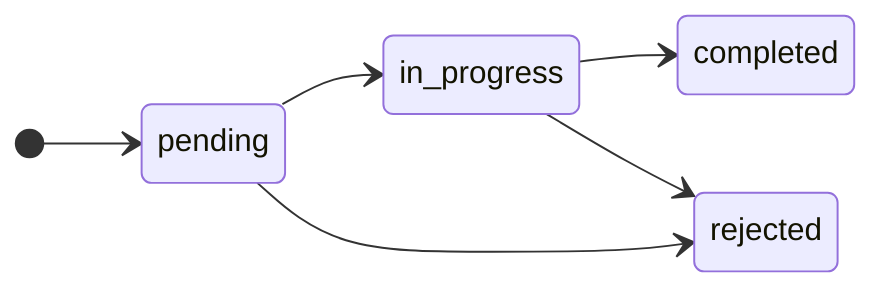

| # | Test | Niveau | État |
|---|---|---|---|
| DOC1 | CRUD centre de renouvellement, désactivation (absent des choix) | C | À faire |
| DOC2 | Demande : transitions valides, transitions interdites refusées | C | OK (`document-renewal-status` : terminée/rejetée 409, en attente → terminée 409, date illisible 400 ; unitaire `document-renewal-statuses`) |
| DOC3 | Échéance proche → alerte ; renouvellement → alerte levée, date mise à jour | I | À faire |

### 3.4 Maintenance et atelier

Tables : `maintenanceSchedules` (`is_active`), `workOrders`, `workOrderItems`, `laborCatalog` (`is_active`), `faultCatalog`, `faultCatalogParts`, `partsUsed`, `timeTracking`, `monthlyTimeStats`.

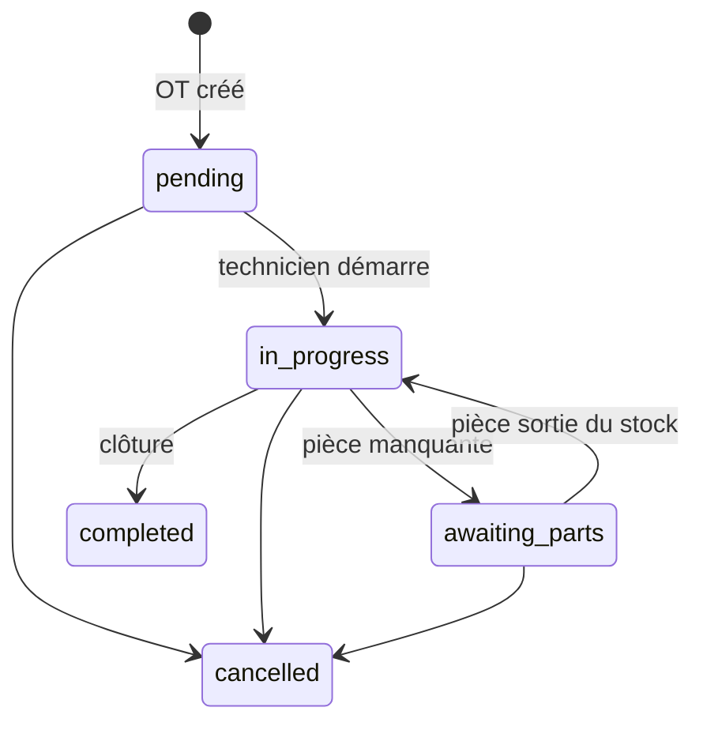

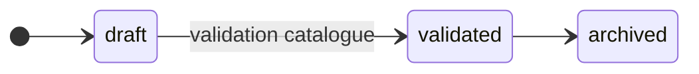

| # | Test | Niveau | État |
|---|---|---|---|
| MNT1 | CRUD plan de maintenance, désactivation (plus de déclenchement) | C | À faire |
| MNT2 | Déclenchement par date et par kilométrage | I | À faire |
| CAT1 | CRUD catalogue main-d'œuvre, désactivation | C | À faire |
| CAT2 | Catalogue de pannes `draft → validated → archived`, pièces associées | C | Partiel (POST : 400 lisible, `createdBy` de la session, `validatedBy` ignoré ; cycle de vie à faire) |
| WO1 | CRUD OT, chaque transition par le bon rôle (chef d'atelier / technicien) | E | Partiel (`03-work-orders`) |
| WO2 | Transitions interdites refusées (ex. `completed → in_progress`) | C | OK (route technicien : `technician-work-order-status` ; `PATCH /api/work-orders/:id` : `work-order-status-transitions`, terminé/annulé 409, technicien hors de ses gestes 403, même statut permis ; unitaires `technician-work-order-transitions`, `work-order-transitions`) |
| WO3 | Lignes de travail OT (lot 3) : ajout, modification, suppression, statuts | U / C | OK (`work-order-items` : saisie, droits, OT terminé/annulé 409, technicien/poste inconnu 400 ; unitaire `work-order-items`) |
| WO4 | Pièces sur OT : prix catalogue, prix client ignoré, rien ne sort à la demande (rayon « à sortir » chez le magasinier, manquant en demande), rayon réservé | C | OK (`work-order-parts`, `stock-issue-permission`) |
| WO5 | Coût OT = base + pièces + pneus, identique UI et PDF | I / E | À faire |
| WO6 | Temps technicien : pointage, agrégation mensuelle | I | À faire |
| WO7 | Notification chef ↔ technicien dans les deux sens | E | À faire |

### 3.5 Magasin : pièces

Tables : `parts` (audit), `partCategories`, `partSpecifications`, `partVariants`, `partsStockMovements`, `partRequirements`.

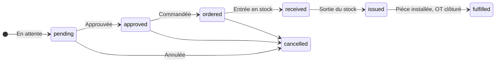

Libellés : source unique `shared/constants/part-requirements.ts` (voir `AGENTS.md` §1).

| # | Test | Niveau | État |
|---|---|---|---|
| PRT1 | CRUD pièce, catégorie, variante, spécification | C | À faire |
| PRT2 | Ajustement de stock → mouvement tracé avec auteur | I | OK (`parts-stock-adjustment` I et C : auteur, concurrence, refus 400/404/409) |
| PRT3 | Stock bas → alerte ; réappro → alerte levée | I | Partiel (`stock-alerts-service`) |
| PRT4 | Demande de pièce : chaîne complète + annulation à chaque étape possible | C | OK (`part-requirements-chain` : chaîne par rôle réel, stock +/− et mouvement attribué vérifiés en base, annulation à chaque étape ; `issued` refusé sans déstockage) |
| PRT5 | Libellés affichés = constantes partagées (aucune table locale) | U | À faire |
| PRT6 | Entrée en stock attribuée au magasinier, pas au demandeur (`receivedBy`) | C | OK (`part-requirements-chain` C : PATCH, corps forgé ignoré ; `part-requirement-received-by` I : commande fournisseur partielle puis complète) |

### 3.6 Magasin : pneus

Tables : `tires` (soft delete `deleted_at`, audit), `vehicleTires`, `tireInspections`, `tireRotations`, `tireRotationDetails`.

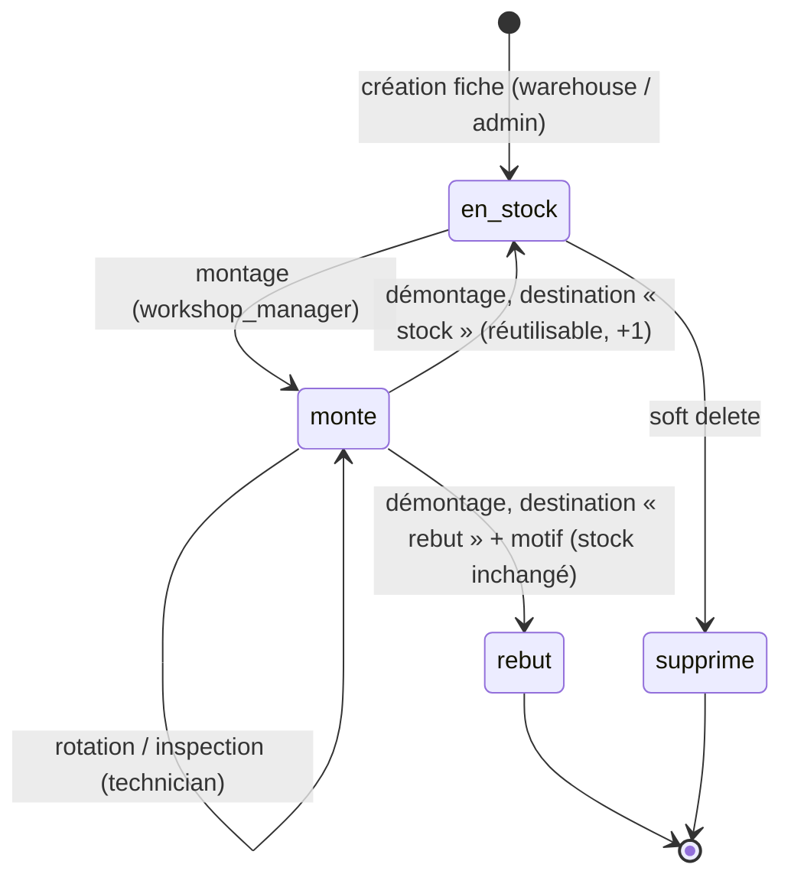

Au démontage, la destination est obligatoire, comme dans RTA Fleet et Eptura : le pneu repart au
stock ou au rebut (usé, endommagé, crevé). Le statut du montage la conserve : `removed` = remis en
stock, sinon la cause du rebut. Le rechapage n'est pas modélisé.

Un pneu remis en stock a roulé : il revient en **usagé** (`tires.used_stock_quantity`), à part du neuf.
Le montage prend du neuf par défaut et trace sa source (`vehicle_tires.stock_source`) ; l'usagé se
choisit explicitement. Seul le neuf est valorisé et suivi en stock bas.

| # | Test | Niveau | État |
|---|---|---|---|
| TIR1 | CRUD fiche pneu par `warehouse` / `admin` ; 403 pour `workshop_manager` | C | OK (`tires-rbac` C : auteur posé par le serveur, corps forgé ignoré ; fiche inexistante 404) |
| TIR2 | Soft delete : non montable, absent du stock, historique conservé | C | OK (`tires-rbac` C : détail et liste 404 / absent, montage 409, modification et 2e suppression 404 ; pneu monté 409) |
| TIR3 | Montage, rotation, démontage par `workshop_manager` | C / E | C OK (`tires-rbac` : stock -1 au montage, démontage vers le stock +1 usagé une seule fois, rebut avec motif sans effet stock, destination obligatoire 400, PATCH générique refuse le statut, rotation invalide 400 sans OT orphelin) ; E OK (`e2e/11` : double clic = 1 requête, trame `vehicle_tire_removed` reçue par le magasinier) |
| TIR4 | Inspection par `technician` | C | OK (`tires-rbac` C : inspecteur = auteur de la requête ; corps invalide 400 `VALIDATION`) |
| TIR5 | Brouillon du wizard : restauré, purgé après succès | E | E OK (`e2e/12` : enregistré pendant la saisie, restauré, purgé après création, une seule fiche ; corrige l'auto-enregistrement de `useFormDraft`) |
| TIR6 | Tableau `PremiumDataTable` : stock bas surligné, corbeille masquée aux non-admin | E | E OK (`e2e/12` : bordure rouge stock bas, corbeille absente pour le magasinier, présente pour l'admin) |
| TIR7 | Stock usagé séparé du neuf : démontage → usagé, montage neuf par défaut, valeur et stock bas sur le neuf | U / C / E | OK (`tires-used-stock` C : démontage usagé +1 neuf inchangé, rebut sans effet, montage neuf par défaut tracé `new`, usagé explicite, usagé à 0 409, neuf à 0 sans source 409 lisible, deux montages concurrents sur 1 usagé 201 + 409, source inconnue 400, valeur sans usagé, stock bas sur le neuf, création usagé forcé à 0, PATCH négatif 400, technicien 403 ; U `tires-used-stock-schema` ; E `e2e/11` : démontage → usagé) |

### 3.7 Approvisionnement

Tables : `suppliers` (`is_active`), `purchaseOrders`, `purchaseOrderLines`, `supplierInvoices`, `supplierInvoiceSettlements`.

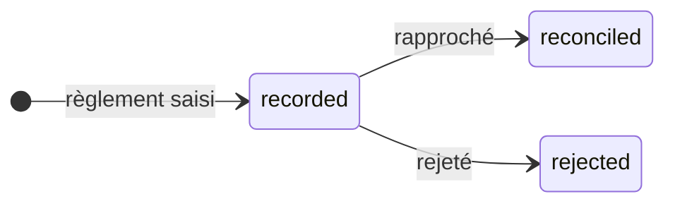

| # | Test | Niveau | État |
|---|---|---|---|
| SUP1 | CRUD fournisseur, désactivation (absent des nouvelles commandes) | C | À faire |
| SUP2 | Évaluation fournisseur par catégorie, selon le rôle | C | À faire |
| PO1 | Commande : création, validation, réception partielle puis totale | E | Partiel (`04-procurement-three-way`) |
| PO2 | Rapprochement commande / réception / facture : écart bloquant | E / C | Partiel (`04-procurement-three-way`) |
| SINV1 | Règlement `recorded → reconciled / rejected`, upload de preuve | C | À faire |
| SINV2 | Double règlement d'une même facture refusé | C | À faire |

### 3.8 Chauffeurs

Tables : `drivers` (`is_active`).

| # | Test | Niveau | État |
|---|---|---|---|
| DRV1 | CRUD chauffeur, désactivation (absent de l'écran PIN et des affectations) | C | À faire |
| DRV2 | Espace chauffeur : missions du jour, déclaration de panne → OT créé | E | À faire |

### 3.9 Carburant

Tables : `fuelRecords`, cartes carburant.

| # | Test | Niveau | État |
|---|---|---|---|
| FUEL1 | CRUD plein et carte carburant | C | Partiel (`fuel-card-service` ; POST/PATCH plein : nombre illisible refusé au lieu d'être tronqué, `secondary-routes-validation`) |
| FUEL2 | Consommation par véhicule | I | À faire |
| FUEL3 | Anomalies : volume > réservoir, kilométrage décroissant | I | À faire |

### 3.10 Clients, missions, facturation

Tables : `clients` (`is_active`), `missions`, `assignments`, `missionSteps`, `clientInvoices`, `clientPayments`.

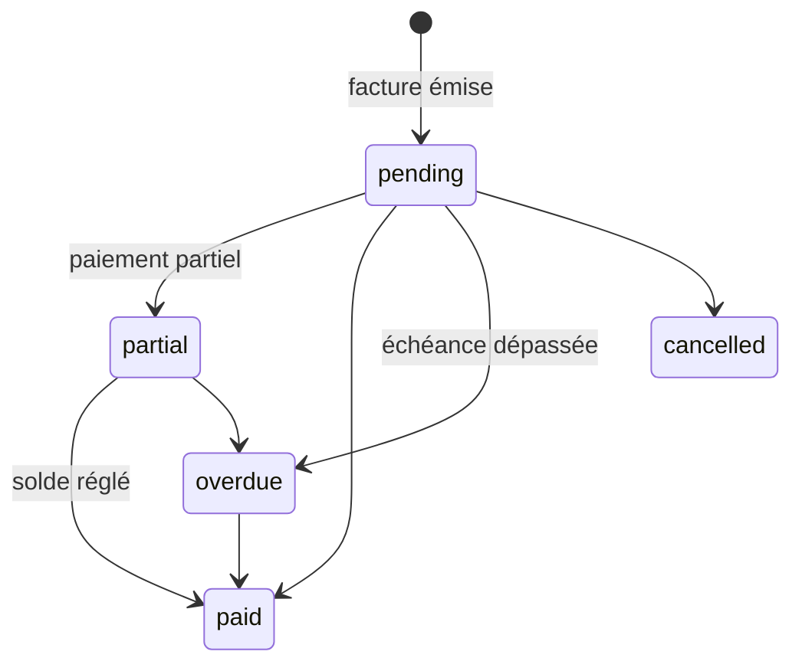

| # | Test | Niveau | État |
|---|---|---|---|
| CLI1 | CRUD client, désactivation | C | À faire |
| MIS1 | Mission : création, affectation véhicule + chauffeur, étapes, clôture | E | À rejouer (`05-mission-billing-payment`) |
| MIS2 | Conflit d'affectation (véhicule ou chauffeur déjà pris) refusé | C | À faire |
| CINV1 | Facture : TVA, paiements partiels, solde | I / E | Partiel (`vat-billing-service`, `05`) |
| CINV2 | Passage automatique en `overdue` | I | À faire |

### 3.11 Alertes et notifications

Tables : `alerts`.

| # | Test | Niveau | État |
|---|---|---|---|
| ALR1 | Génération planifiée sans doublon (deux passages = une alerte) | I | À faire |
| ALR2 | Marquer lu / tout marquer lu, compteur mis à jour | C | À faire |
| ALR3 | Notification temps réel reçue par le bon rôle uniquement | E | À faire |

### 3.12 Direction, rapports, exports

Tables : `fleetKpiCache`.

| # | Test | Niveau | État |
|---|---|---|---|
| DIR1 | KPI recalculés après chaque transition métier | I | Partiel (`management-dashboard-service`) |
| DIR2 | Rapports filtrés par période | C | À faire |
| DIR3 | Exports CSV / PDF : contenu exact, droits par rôle | C | À faire |

---

## 4. Parcours bout en bout inter-rôles

### P1 — Panne → OT → réappro → facture fournisseur

État : **OK** (recette manuelle `docs/qa/E2E PANNE-OT-REAPPRO-FACTURE`, 18 étapes PASS).

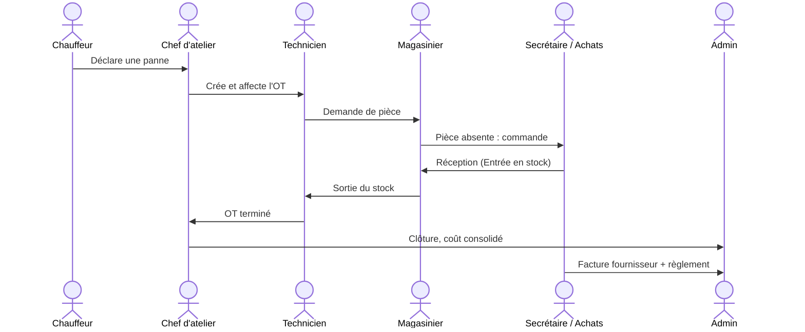

### P2 — Mission → facture client → paiement

État : **À rejouer** (`e2e/05-mission-billing-payment.spec.ts`).

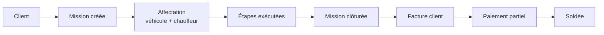

### P3 — Maintenance préventive

État : **À faire**.

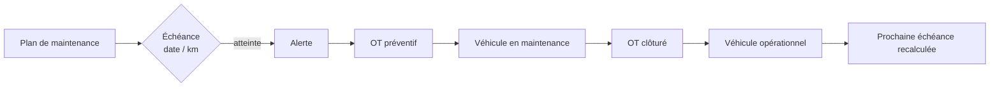

### P4 — Renouvellement documentaire

État : **À faire**.

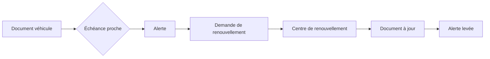

### P5 — Cycle de vie d'un pneu

État : **À faire**.

### P6 — Stock bas → réapprovisionnement

État : **Partiel** (service d'alertes testé, pas le parcours complet).

---

## 5. Synthèse et priorités

| Priorité | Lot | Justification |
|---|---|---|
| 1 | T1, T3, T4, T7 | Sécurité et intégrité, valables partout |
| 2 | PRT4, PRT6, TIR1–TIR4 | Traçabilité stock, dette connue, RBAC pneus déjà corrigé une fois |
| 3 | WO2, WO3, WO5 | Lot 3 en cours, coût OT |
| 4 | P2 (rejouer), P3, P6 | Parcours métier les plus utilisés après P1 |
| 5 | Soft delete : ADM3, VEH2, TIR2 + désactivations | Données historiques à préserver |
| 6 | DOC, FUEL, ALR, DIR | Modules de support |

Commandes : voir `AGENTS.md` §8 et `tests/README.md`.
