# Plan de couverture des tests par module

Objectif : couvrir chaque module en **CRUD**, **suppression (soft delete / désactivation)**,
**workflows (transitions de statut)** et **RBAC**, puis les parcours bout en bout inter-rôles.

Sources : `shared/schema.ts` (tables, statuts, colonnes `deleted_at` / `is_active`),
`shared/constants/` (statuts des demandes de pièce, lignes OT), suites existantes
(`e2e/`, `tests/contract/`, `tests/integration/`).

## Légende

| Niveau | Outil | Emplacement |
|---|---|---|
| **U** | Vitest unitaire, sans base | `tests/unit/` |
| **I** | Vitest services + `DATABASE_URL_TEST` | `tests/integration/` |
| **C** | Vitest HTTP in-process + `DATABASE_URL_TEST` | `tests/contract/` |
| **E** | Playwright | `e2e/` |
| **M** | Recette manuelle | `docs/qa/` |

| État | Sens |
|---|---|
| OK | Test existant et vert |
| Partiel | Test existant, ne couvre pas tous les cas listés |
| À rejouer | Test existant, non relancé récemment |
| À faire | Aucun test |

Règle des tests en base : tout ce qui est créé est supprimé en fin de test (préfixe `TEST-`).
Arrêter le serveur de dev avant les tests de contrat (le planificateur d'alertes bloque la purge).

---

## 1. Carte des modules

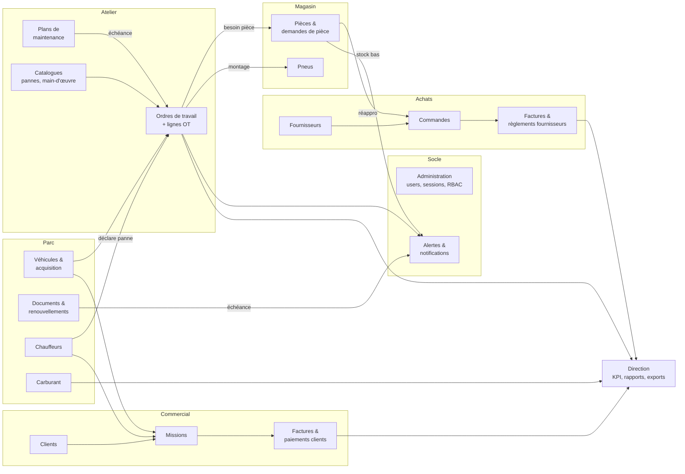

---

## 2. Tests transverses (tous modules)

| # | Test | Niveau | État |
|---|---|---|---|
| T1 | Toute route `/api` : 401 sans session, 403 avec rôle non autorisé | C / E | OK avec cliquet (`write-routes-ratchet` : 23 routes d'écriture sans garde de rôle gelées, la liste ne peut que rétrécir) ; reste gelé, détail : `api-auth-guard` statique ; 403 par session réelle sur 7 POST principaux dans `api-role-guard-and-validation`, sur l'ajustement de stock et sur la saisie/modification d'un plein (`fuel-records-and-document-paths`) ; cloison entre clients et saisies réservées au personnel (`vehicle-documents-client-scope`) ; lectures de véhicule avec deux clients et le personnel : liste, `/all`, détail par id et par immatriculation, véhicule sans propriétaire, inconnu (`vehicles-two-clients-isolation`) ; E : 403 forgé au contrat d'erreur, bouton de paiement désactivé avec sa raison, corbeille pièce masquée au magasinier, `e2e/07`, `e2e/08` |
| T2 | Sessions : création, expiration, révocation, logout | C | OK (`api-auth-sessions`) |
| T3 | Body invalide → 400 Zod avec message actionnable | C | OK avec cliquet (`write-routes-ratchet` : 32 routes lisant `req.body` sans validation gelées) ; reste gelé, détail : 7 POST principaux + PATCH véhicule, OT, fournisseur, client, pièce, pneu, panne couverts par `api-role-guard-and-validation` ; ajustement de stock ; PATCH document, planification, utilisateur, POST/PATCH plein carburant, POST catalogue de pannes dans `secondary-routes-validation` ; E : toast métier sans détail technique, `e2e/08` ; reste les autres routes de `server/routes.ts`, à brancher sur `prepareColumnUpdate` |
| T4 | Champs serveur ignorés si envoyés par le client (`created_by`, `updated_by`, prix, totaux) | C | OK avec cliquet (`write-routes-ratchet` : 32 routes lisant `req.body` sans protection des champs serveur gelées) ; reste gelé, détail : prix pièce OT, champs d'audit au PATCH pièce, `requestedBy` et statut/date de livraison à la création d'une demande de pièce, ratchet `insert-schemas-server-fields` ; commande fournisseur : totaux recalculés, remise bornée 0..100, quantités reçues bornées et jamais en baisse, `purchase-order-amounts` ; facture client : montant borné, TVA/TTC recalculés, `client-invoice-generate` ; facture fournisseur : champs du workflow ignorés, solde initial = TTC, `supplier-invoice-create` |
| T5 | Audit `parts` / `tires` : `created_by` + `updated_by` à la création, `updated_by` à chaque modification | I | Fait en I (`stock-audit-columns` : created_by/updated_by/dates des pièces et pneus par le service, trois utilisateurs distincts, suppression logique, noms joints) ; routes HTTP non couvertes |
| T6 | Règle des 3 couches : cache local, trame WebSocket chez un autre rôle, invalidation liste + KPI | E | Partiel (`06-realtime-work-orders` ; `14-realtime-work-order-roles` : trames `work_order_created` chez le technicien et `work_order_updated` chez le chef d'atelier ; `15-realtime-work-order-satellites` : création, démarrage, fin et suppression, trame puis refetch observé de `/api/work-orders/statistics` et de la liste chez le chef (sans polling) en moins de 5 s ; OK) |
| T7 | Idempotence : double soumission sans doublon (paiement, réception, sortie de stock) | C / E | Fait (réception et sortie de stock, règlement et rapprochement fournisseur, encaissement client, ajustement de stock ; E : double clic encaissement et ajustement, `e2e/07` ; garde `useSingleFlightMutate` aussi sur règlement et rapprochement fournisseur, réception et sortie de demande, sortie depuis l'OT, livraison de commande) |
| T8 | Listes : pagination, filtres, recherche, éléments supprimés exclus | C | Partiel (`lists-pagination-filters`, 55 cas : véhicules, ordres de travail, pièces, fournisseurs ; pages sans doublon ni trou, total, tri, filtres, supprimé exclu, liste vide, bornes, apostrophe et injection ; 17 `it.fails` à l'époque : jokers `%` et `_` non échappés, `offset` négatif ou `limit` démesuré (liste vide silencieuse, 500 sur les pièces), octet nul 500, `isActive` invalide, véhicules non cloisonnés pour un client (corrigé par #80, couvert à deux clients par `vehicles-two-clients-isolation`). Missions et documents : pas de pagination côté serveur) |

---

## 3. Tests par module

### 3.1 Administration et utilisateurs

Tables : `users` (soft delete `deleted_at`), `userOnboarding`, `activityLogs`.

| # | Test | Niveau | État |
|---|---|---|---|
| ADM1 | CRUD utilisateur par admin, 403 pour les autres rôles | C | OK (`users-admin-soft-delete` : 403 non-admin sur POST/PATCH/DELETE, 401 anonyme, auto-suppression 400 ; PATCH : `secondary-routes-validation`) |
| ADM2 | Changement de rôle : menus et droits appliqués à la session suivante | E | À faire |
| ADM3 | Soft delete : connexion refusée, session révoquée, absent des listes, historique conservé | C | OK (`users-admin-soft-delete` ; défaut corrigé : un compte supprimé se reconnectait et gardait sa session) |
| ADM4 | Login / logout, mauvais mot de passe | E | OK (`01-auth-login`) |
| ADM5 | PIN chauffeur : bon PIN, mauvais PIN, chauffeur désactivé | C | OK (`driver-pin-login`, 7 cas ; fiche `drivers` désactivée : voir DRV1) |
| ADM6 | Journal d'activité alimenté sur les actions sensibles | I | OK (`audit-sensitive-actions`, 3 cas : création, rôle, suppression, 403 sans ligne) |

### 3.2 Parc véhicules

Tables : `vehicles` (soft delete `deleted_at`), `vehicleAcquisitionWorkflows`, `workflowDocuments`, `vehicleDocuments`, `statusHistory`.

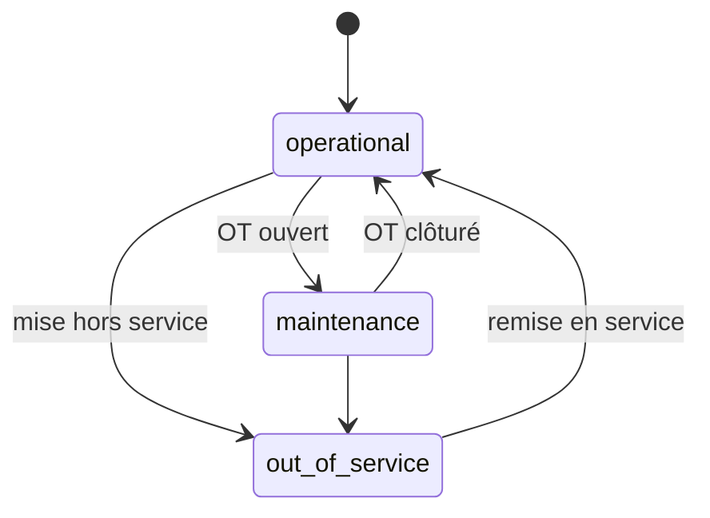

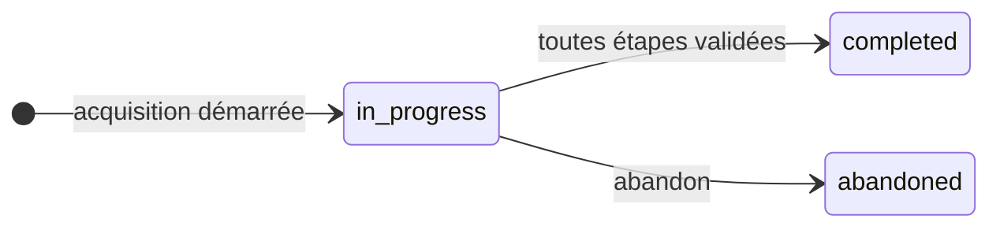

| # | Test | Niveau | État |
|---|---|---|---|
| VEH1 | CRUD véhicule, unicité immatriculation | E / C | Partiel (`02-fleet-vehicles`, contrat `vehicles-crud` : 4 défauts figés) |
| VEH2 | Soft delete : masqué, OT et missions passés consultables, non assignable | C | Partiel : masqué et consultable OK ; 3 défauts en `it.fails` (suppression physique, OT et mission sur véhicule supprimé) |
| VEH3 | Acquisition : reprise de l'étape en cours, documents joints, `completed` / `abandoned` | E | Contrat OK (`vehicle-acquisition-workflow` : 5 défauts figés) ; e2e à faire |
| VEH4 | Statut synchronisé avec ouverture / clôture d'OT, tracé dans `statusHistory` | I | Partiel (intégration `vehicle-status-sync` : 7 verts, OT annulé laisse le véhicule en maintenance : `it.fails`) |

### 3.3 Documents et renouvellements

Tables : `documentRenewalCenters` (`is_active`), `documentRenewalRequests`.

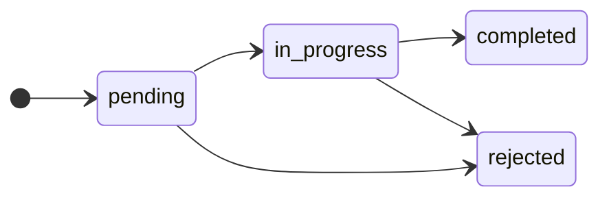

| # | Test | Niveau | État |
|---|---|---|---|
| DOC1 | CRUD centre de renouvellement, désactivation (absent des choix) | C | À faire |
| DOC2 | Demande : transitions valides, transitions interdites refusées | C | OK (`document-renewal-status` : terminée/rejetée 409, en attente → terminée 409, date illisible 400 ; unitaire `document-renewal-statuses`) |
| DOC3 | Échéance proche → alerte ; renouvellement → alerte levée, date mise à jour | I | OK (`document-quick-renew-alerts` : échéance mise à jour, alertes due/expired du document levées, celles d'un autre document gardées ; défaut corrigé : alertes laissées en place) |

### 3.4 Maintenance et atelier

Tables : `maintenanceSchedules` (`is_active`), `workOrders`, `workOrderItems`, `laborCatalog` (`is_active`), `faultCatalog`, `faultCatalogParts`, `partsUsed`, `timeTracking`, `monthlyTimeStats`.

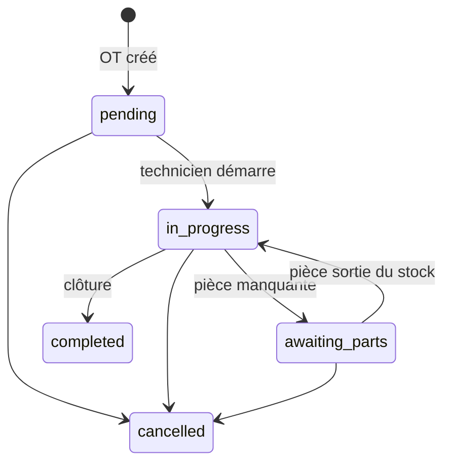

| # | Test | Niveau | État |
|---|---|---|---|
| MNT1 | CRUD plan de maintenance, désactivation (plus de déclenchement) | C | Partiel : CRUD, droits, 400/404, cloison client, désactivation OK ; 1 défaut en `it.fails` (DELETE répond 204 sans supprimer) |
| MNT2 | Déclenchement par date et par kilométrage | I | Partiel : fenêtre 30 jours, seuil km, plan inactif OK ; 2 défauts en `it.fails` (échéance du plan ignorée, doublon km) |
| CAT1 | CRUD catalogue main-d'œuvre, désactivation | C | Partiel : création, lecture, droits, doublon, concurrence, poste inactif refusé sur OT OK ; 1 manque en `it.fails` (aucune route de désactivation) |
| CAT2 | Catalogue de pannes `draft → validated → archived`, pièces associées | C | Partiel (cycle de vie au contrat ; `validatedBy` forgeable et non renseigné, id inconnu en 200 : `it.fails` ; pièces associées sans route) |
| WO1 | CRUD OT, chaque transition par le bon rôle (chef d'atelier / technicien) | E | Partiel (`03-work-orders` ; `14-realtime-work-order-roles` : création par le chef d'atelier, démarrage par le technicien affecté, autre technicien refusé 403 ; `15-…` : fin d'intervention par le technicien, correction par le chef, création et suppression refusées au technicien, suppression par le chef + trame `work_order_deleted`) |
| WO2 | Transitions interdites refusées (ex. `completed → in_progress`) | C | OK (route technicien : `technician-work-order-status` ; `PATCH /api/work-orders/:id` : `work-order-status-transitions`, terminé/annulé 409, technicien hors de ses gestes 403, même statut permis ; unitaires `technician-work-order-transitions`, `work-order-transitions`) |
| WO3 | Lignes de travail OT (lot 3) : ajout, modification, suppression, statuts | U / C | OK (`work-order-items` : saisie, droits, OT terminé/annulé 409, technicien/poste inconnu 400 ; unitaire `work-order-items`) |
| WO4 | Pièces sur OT : prix catalogue, prix client ignoré, rien ne sort à la demande (rayon « à sortir » chez le magasinier, manquant en demande), rayon réservé | C | OK (`work-order-parts`, `stock-issue-permission`) |
| WO5 | Coût OT = base + pièces + pneus, identique UI et PDF | I / E | OK (formule unique `shared/work-order-cost.ts` pour écran et PDF ; U `work-order-cost` : NaN impossible, arrondi au centime ; I `work-order-cost` : service technicien = formule ; I `kpi-service` : coût moyen inclut les rotations, sans produit cartésien) |
| WO6 | Temps technicien : pointage, agrégation mensuelle | I | Partiel (`time-tracking` contrat 5 cas, intégration 3 cas : saisie rejouable, totaux mensuels, chauffeur inactif ; bord de mois, d'année, 29 février et fuseau (4 fuseaux) couverts par `time-tracking-month-boundary` ; 2 défauts en `it.fails` : une date impossible comme 2033-02-30 sort en erreur de base au lieu de 400) |
| WO7 | Notification chef ↔ technicien dans les deux sens | E | Partiel (`14-realtime-work-order-roles` : chef vers technicien, alerte d'affectation + trame ; technicien vers chef, trame de démarrage ; `15-…` : alerte « Intervention démarrée » vers le chef figée en `test.fail` : défaut `server/api/technician-work-orders.routes.ts:96`, la route technicien n'appelle jamais `notifyWorkOrderProgress`) |

### 3.5 Magasin : pièces

Tables : `parts` (audit), `partCategories`, `partSpecifications`, `partVariants`, `partsStockMovements`, `partRequirements`.

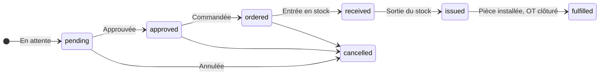

Libellés : source unique `shared/constants/part-requirements.ts` (voir `AGENTS.md` §1).

| # | Test | Niveau | État |
|---|---|---|---|
| PRT1 | CRUD pièce, catégorie, variante, spécification | C | Partiel (contrat `parts-catalog-crud` ; doublon de référence, prix non numérique, stock négatif, suppression inconnue en 500/201 : `it.fails` ; variante et spécification sans route) |
| PRT2 | Ajustement de stock → mouvement tracé avec auteur | I | OK (`parts-stock-adjustment` I et C : auteur, concurrence, refus 400/404/409) |
| PRT3 | Stock bas → alerte ; réappro → alerte levée | I | Fait en I (`stock-alert-lifecycle`) ; export « Alerte CDE » suit le stock (défaut corrigé) |
| PRT4 | Demande de pièce : chaîne complète + annulation à chaque étape possible | C | OK (`part-requirements-chain` : chaîne par rôle réel, stock +/− et mouvement attribué vérifiés en base, annulation à chaque étape ; `issued` refusé sans déstockage) |
| PRT5 | Libellés affichés = constantes partagées (aucune table locale) | U | À faire |
| PRT6 | Entrée en stock attribuée au magasinier, pas au demandeur (`receivedBy`) | C | OK (`part-requirements-chain` C : PATCH, corps forgé ignoré ; `part-requirement-received-by` I : commande fournisseur partielle puis complète) |

### 3.6 Magasin : pneus

Tables : `tires` (soft delete `deleted_at`, audit), `vehicleTires`, `tireInspections`, `tireRotations`, `tireRotationDetails`.

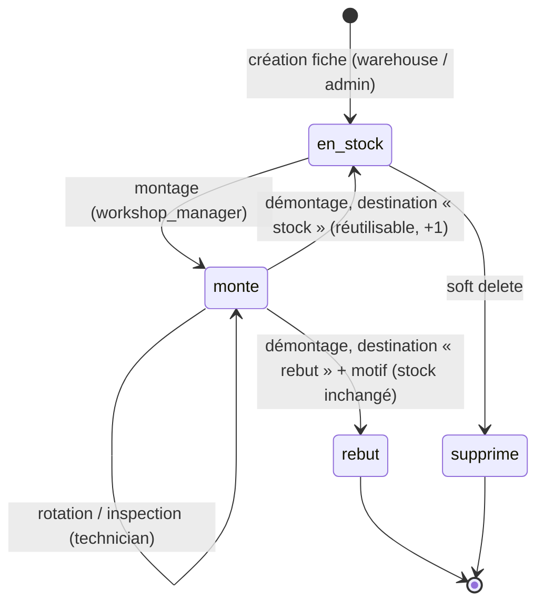

Au démontage, la destination est obligatoire, comme dans RTA Fleet et Eptura : le pneu repart au
stock ou au rebut (usé, endommagé, crevé). Le statut du montage la conserve : `removed` = remis en
stock, sinon la cause du rebut. Le rechapage n'est pas modélisé.

Un pneu remis en stock a roulé : il revient en **usagé** (`tires.used_stock_quantity`), à part du neuf.
Le montage prend du neuf par défaut et trace sa source (`vehicle_tires.stock_source`) ; l'usagé se
choisit explicitement. Seul le neuf est valorisé et suivi en stock bas.

| # | Test | Niveau | État |
|---|---|---|---|
| TIR1 | CRUD fiche pneu par `warehouse` / `admin` ; 403 pour `workshop_manager` | C | OK (`tires-rbac` C : auteur posé par le serveur, corps forgé ignoré ; fiche inexistante 404) |
| TIR2 | Soft delete : non montable, absent du stock, historique conservé | C | OK (`tires-rbac` C : détail et liste 404 / absent, montage 409, modification et 2e suppression 404 ; pneu monté 409) |
| TIR3 | Montage, rotation, démontage par `workshop_manager` | C / E | C OK (`tires-rbac` : stock -1 au montage, démontage vers le stock +1 usagé une seule fois, rebut avec motif sans effet stock, destination obligatoire 400, PATCH générique refuse le statut, rotation invalide 400 sans OT orphelin) ; E OK (`e2e/11` : double clic = 1 requête, trame `vehicle_tire_removed` reçue par le magasinier) |
| TIR4 | Inspection par `technician` | C | OK (`tires-rbac` C : inspecteur = auteur de la requête ; corps invalide 400 `VALIDATION`) |
| TIR5 | Brouillon du wizard : restauré, purgé après succès | E | E OK (`e2e/12` : enregistré pendant la saisie, restauré, purgé après création, une seule fiche ; corrige l'auto-enregistrement de `useFormDraft`) |
| TIR6 | Tableau `PremiumDataTable` : stock bas surligné, corbeille masquée aux non-admin | E | E OK (`e2e/12` : bordure rouge stock bas, corbeille absente pour le magasinier, présente pour l'admin) |
| TIR7 | Stock usagé séparé du neuf : démontage → usagé, montage neuf par défaut, valeur et stock bas sur le neuf | U / C / E | OK (`tires-used-stock` C : démontage usagé +1 neuf inchangé, rebut sans effet, montage neuf par défaut tracé `new`, usagé explicite, usagé à 0 409, neuf à 0 sans source 409 lisible, deux montages concurrents sur 1 usagé 201 + 409, source inconnue 400, valeur sans usagé, stock bas sur le neuf, création usagé forcé à 0, PATCH négatif 400, technicien 403 ; U `tires-used-stock-schema` ; E `e2e/11` : démontage → usagé) |

### 3.7 Approvisionnement

Tables : `suppliers` (`is_active`), `purchaseOrders`, `purchaseOrderLines`, `supplierInvoices`, `supplierInvoiceSettlements`.

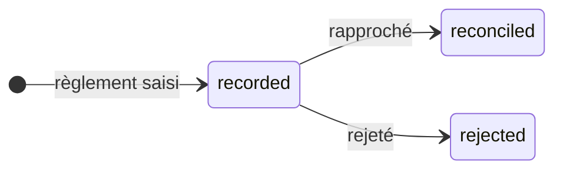

| # | Test | Niveau | État |
|---|---|---|---|
| SUP1 | CRUD fournisseur, désactivation (absent des nouvelles commandes) | C | Partiel (contrat `suppliers-crud-ratings` ; nom en doublon en 500, commande vers fournisseur désactivé acceptée : `it.fails`) |
| SUP2 | Évaluation fournisseur par catégorie, selon le rôle | C | Partiel (matrice rôle x critère x catégorie au contrat ; le chef d'atelier est refusé par le montage de `/suppliers` : `it.fails`) |
| PO1 | Commande : création, validation, réception partielle puis totale | E | Fait en C (`purchase-order-lifecycle.contract`) en plus de `04` |
| PO2 | Rapprochement commande / réception / facture : écart bloquant | E / C | Fait en C (`purchase-order-three-way.contract`) ; défauts 5 % et commande inconnue corrigés |
| SINV1 | Règlement `recorded → reconciled / rejected`, upload de preuve | C | OK (`supplier-settlement-reject` : rejet avec motif et auteur, libère le reste à régler, rejeu idempotent, motif vide 400, rapproché 409, rejeté non rapprochable 409, autre facture 404, magasinier 403 ; U `supplier-settlement-reject-schema`) |
| SINV2 | Double règlement d'une même facture refusé | C | OK (déjà couvert par T7 : `supplier-settlement-idempotence` C et I, rejeu même référence, dépassement du total 409, saisies simultanées) |

### 3.8 Chauffeurs

Tables : `drivers` (`is_active`).

| # | Test | Niveau | État |
|---|---|---|---|
| DRV1 | CRUD chauffeur, désactivation (absent de l'écran PIN et des affectations) | C | Partiel (`drivers-crud-deactivation` : CRUD et RBAC OK ; 2 défauts en `it.fails` : chauffeur désactivé encore affectable, encore sur l'écran PIN) |
| DRV2 | Espace chauffeur : missions du jour, déclaration de panne → OT créé | E | À faire |

### 3.9 Carburant

Tables : `fuelRecords`, cartes carburant.

| # | Test | Niveau | État |
|---|---|---|---|
| FUEL1 | CRUD plein et carte carburant | C | Fait en C, 6 défauts figés (`fuel-card-routes` : recharge et consommation 401/403/400, solde et crédits/débits par différence, historique filtré, statistiques mensuelles, liste et suppression des pleins ; `it.fails` : date de recharge illisible 500, quantité illisible ou négative acceptées en 201, véhicule inconnu 500, solde insuffisant 500, client lit les pleins d'un véhicule tiers) ; `fuel-card-service`, `secondary-routes-validation` |
| FUEL2 | Consommation par véhicule | I | Partiel (contrat `fuel-vehicle-stats` : totaux, prix au litre, station, zéros, rôles, 400 ; `it.fails` : véhicule inconnu, 500 au lieu de 404) |
| FUEL3 | Anomalies : volume > réservoir, kilométrage décroissant | I | À faire |

### 3.10 Clients, missions, facturation

Tables : `clients` (`is_active`), `missions`, `assignments`, `missionSteps`, `clientInvoices`, `clientPayments`.

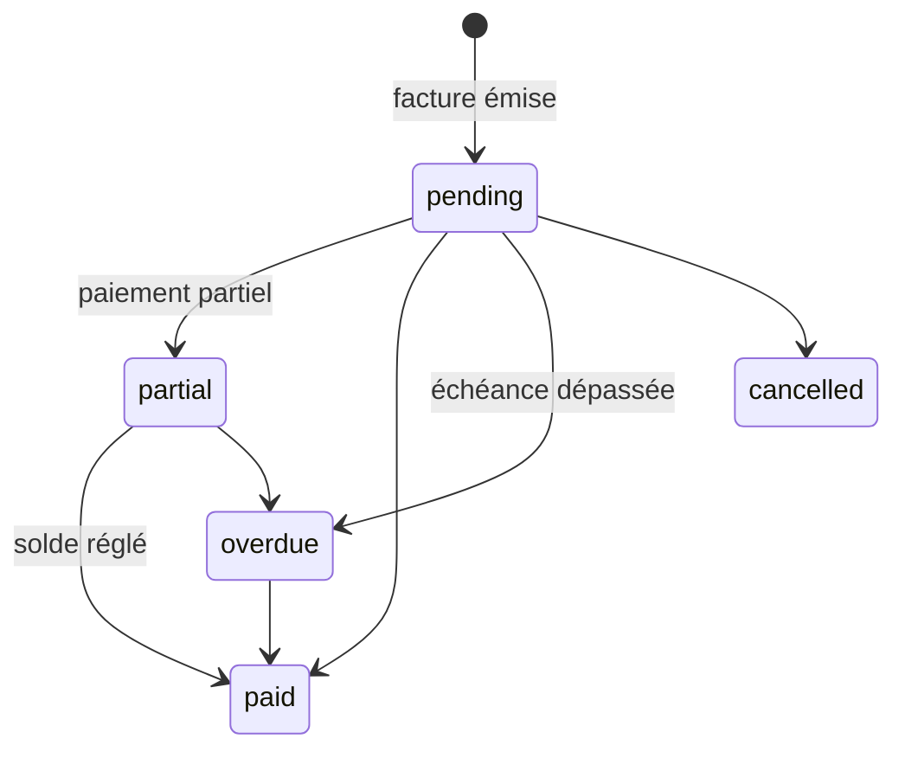

| # | Test | Niveau | État |
|---|---|---|---|
| CLI1 | CRUD client, désactivation | C | OK (contrat `clients-crud`) |
| MIS1 | Mission : création, affectation véhicule + chauffeur, étapes, clôture | E | Partiel (`13-mission-invoice-payment` : création par l'API logistique, passage à « livrée » en base ; affectation, étapes et lancement non rejoués) |
| MIS2 | Conflit d'affectation (véhicule ou chauffeur déjà pris) refusé | C | OK (`mission-planning-conflict`, 1 défaut figé) |
| CINV1 | Facture : TVA, paiements partiels, solde | I / E | Fait en C (`client-invoice-payments.contract`) en plus de `vat-billing-service`, `05` |
| CINV2 | Passage automatique en `overdue` | I | OK (`client-invoice-overdue` : échues non soldées seulement, échéance du jour exclue, payée/annulée intactes, second passage sans écriture, paiement partiel garde le retard, solde → payée) |

### 3.11 Alertes et notifications

Tables : `alerts`.

| # | Test | Niveau | État |
|---|---|---|---|
| ALR1 | Génération planifiée sans doublon (deux passages = une alerte) | I | Fait : une par jour, concurrence et alerte lue corrigées |
| ALR2 | Marquer lu / tout marquer lu, compteur mis à jour | C | Fait : propriétaire vérifié (défaut corrigé), « tout lu » ajouté |
| ALR3 | Notification temps réel reçue par le bon rôle uniquement | E | Fait au niveau I (scope user par destinataire) ; e2e non joué |

### 3.12 Direction, rapports, exports

Tables : `fleetKpiCache`.

| # | Test | Niveau | État |
|---|---|---|---|
| DIR1 | KPI recalculés après chaque transition métier | I | Fait en C (`management-dashboard-kpis` : OT en cours puis terminé, OT annulé, statut véhicule, plein saisi puis supprimé, facture fournisseur ; accès 401/403) ; `management-dashboard-service` en I |
| DIR2 | Rapports filtrés par période | C | Fait en C (`reports-inventory-period` : mouvements de la fenêtre, bornes incluses, valeur absolue, statistiques, fenêtre vide ; `reports-technician-period` : totaux et taux par technicien et globaux, bornes, fenêtre vide ; export carburant couvert avant). 6 `it.fails` : client et chauffeur non refusés sur les deux rapports (`server/routes.ts:2840`, `2894`), date invalide non refusée en 400 |
| DIR3 | Exports CSV / PDF : contenu exact, droits par rôle | C | Partiel (XLSX : carburant, inventaire (`exports-inventory-content`), factures fournisseurs et clients (`exports-invoices-content`) en cellules exactes ; droits dans `lot-exports-roles`. Non couverts : exports missions clients, rapport mensuel, véhicules, OT, utilisateurs, complet ; PDF/CSV générés côté navigateur (`pdf-export.ts`) hors de portée du contrat) |

---

## 4. Parcours bout en bout inter-rôles

### P1 — Panne → OT → réappro → facture fournisseur

État : **OK** (recette manuelle `docs/qa/E2E PANNE-OT-REAPPRO-FACTURE`, 18 étapes PASS).

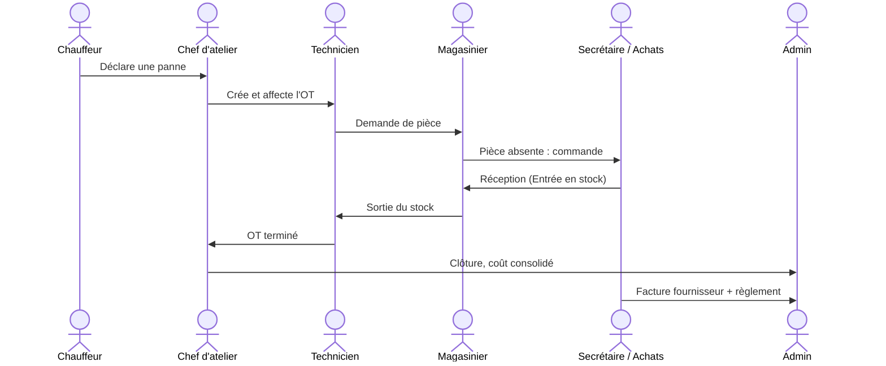

### P2 — Mission → facture client → paiement

État : **Partiel** au navigateur (`e2e/13-mission-invoice-payment.spec.ts` : mission créée, facture générée depuis l'écran mission, deux paiements par la secrétaire, soldée, logistique sans bouton de paiement actif ; données créées puis supprimées). La mission est posée à « livrée » en base : le lancement n'est pas rejoué.

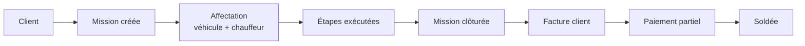

### P3 — Maintenance préventive

État : **Partiel** : plan → échéance date/km → OT préventif → véhicule en maintenance couvert (MNT1, MNT2) ; alerte, clôture de l'OT → véhicule opérationnel et recalcul de la prochaine échéance par date non couverts.

### P4 — Renouvellement documentaire

État : **OK** (`document-quick-renew-alerts` : alerte → demande → en cours → renouvelé ; une seule demande, close ; document à jour ; alerte levée).

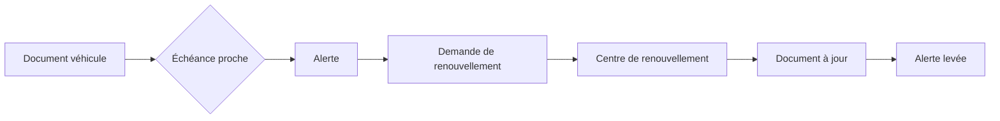

### P5 — Cycle de vie d'un pneu

État : **Contrat OK** (`p5-tire-lifecycle` : entrée en stock par le magasinier, montage neuf, suppression refusée tant que monté, inspection, rotation, démontage vers le stock (usagé +1), remontage explicite de l'usagé, rebut, suppression refusée au magasinier puis acceptée à l'admin, historique conservé ; stock vérifié à chaque étape). Pas d'e2e : aucun maillon ne se prouve seulement au navigateur.

### P6 — Stock bas → réapprovisionnement

État : **Contrat OK** (`p6-low-stock-to-restock` : sortie sous le seuil, alerte avec manque, commande fournisseur de brouillon à confirmée sans effet sur l'alerte, réception par le magasinier (+10, une entrée de stock à son nom), alerte levée, demande reçue, réception rejouée sans crédit en double ; réception refusée au technicien ; réception partielle qui laisse l'alerte). Pas d'e2e.

---

## 5. Synthèse et priorités

| Priorité | Lot | Justification |
|---|---|---|
| 1 | T1, T3, T4, T7 | Sécurité et intégrité, valables partout |
| 2 | PRT4, PRT6, TIR1–TIR4 | Traçabilité stock, dette connue, RBAC pneus déjà corrigé une fois |
| 3 | WO2, WO3, WO5 | Lot 3 en cours, coût OT |
| 4 | P2 (rejouer), P3, P6 | Parcours métier les plus utilisés après P1 |
| 5 | Soft delete : ADM3, VEH2, TIR2 + désactivations | Données historiques à préserver |
| 6 | DOC, FUEL, ALR, DIR | Modules de support |

Commandes : voir `AGENTS.md` §8 et `tests/README.md`.
